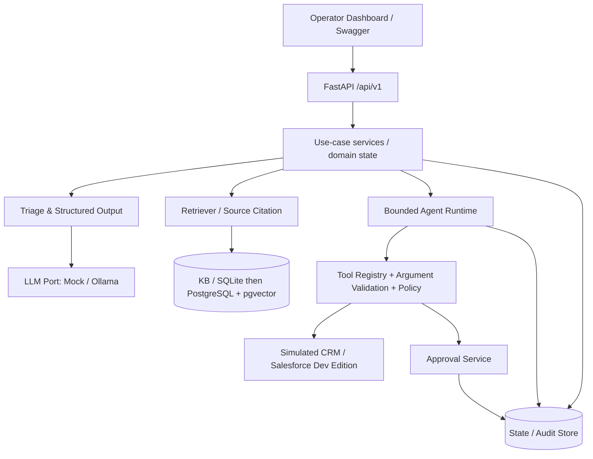

# Architecture v0.1

## Guiding principles
Hexagonal boundaries; deterministic business logic; provider-swappable LLM; no LLM direct write privileges; durable state; every result traceable to a source and tool invocation. Keep the first two weeks smaller than the eventual design.

## Architecture diagram


## Runtime strategy
**Week 1:** FastAPI + Pydantic + pure-Python deterministic triage + SQLite only if actually required. Offline tests mandatory. NO Docker, Salesforce token, ngrok or local LLM required.
**Week 2:** Introduce `LLMPort.classify(ticket) -> TriageResult`, `MockLLM` for tests and optional `OllamaLLM` behind configuration. Local inference availability is non-blocking.
**Weeks 3–4:** Retrieval baseline first (term search / SQLite FTS); then embeddings and pgvector only after quality comparison.
**Weeks 5–8:** Build a tiny bounded agent loop by hand to learn tool calling, then evaluate LangGraph for durable state and approvals.
**Weeks 9–12:** CI, deployment, isolated Salesforce Developer Edition adapter, reproducible release.

## Domain objects (draft contracts)
- Ticket: id, created_at, locale, subject, description, status, category?, priority?, version.
- TriageResult: category (payment_issue/access_issue/general/other), priority (low/medium/high/critical), summary, needs_human_review, rationale, model_info.
- SourceCitation: source_id, document_title, chunk_id, retrieved_at.
- ToolCall: call_id, tool_name, validated_arguments, permitted_scope, execution_state.
- ActionProposal: id, ticket_id, action_type, target_id, before/after diff, reasons, citations, expires_at.
- ApprovalDecision: proposal_id, actor_id, decision (approve/reject), decided_at, scope_hash.
- AuditEvent: event_id, trace_id, actor, transition, type, occurred_at, masked_detail.

## Proposed API (contracts are versioned)
| Route | Response intent |
|---|---|
| GET /health/live | process liveness; no dependency readiness claim |
| GET /health/ready | readiness including configured dependencies |
| POST /api/v1/tickets | create synthetic ticket |
| GET /api/v1/tickets/{ticket_id} | view current state |
| POST /api/v1/tickets/{ticket_id}/triage | classify and validate |
| POST /api/v1/runs | start a bounded investigation |
| GET /api/v1/runs/{run_id} | status + sanitized trace |
| POST /api/v1/proposals/{proposal_id}/decisions | authenticated human approve/reject |
| GET /api/v1/audit?ticket_id=... | authorized audit browsing |

Example triage response (illustrative, **not measured**):
```json
{
  "category": "payment_issue",
  "priority": "high",
  "summary": "決済時にエラーが発生する",
  "needs_human_review": true,
  "rationale": "Payment failed for a user",
  "model_info": "mock:v1"
}
```

## Trust boundaries
1. API input: length caps, locale, explicit request schema and throttling before model call.
2. Retrieved data: **untrusted**, never parsed as system instructions. Source IDs validated by retrieval store.
3. Model output: always validated; model cannot issue SQL, shell commands, arbitrary URLs or unchecked tool names.
4. Tool executor: deterministic authorization/allowlist + approval check + validated args + idempotency before any write.
5. Salesforce adapter: only isolated Developer Edition. Use minimum OAuth scopes and separate test data.
6. Audit: append-only logical records and redaction; do not promise tamper-proof security without deployment hardening.

## Failures and recovery
- LLM timeout: bounded retry for reads only, typed 503 and trace.
- Invalid JSON/schema: one limited repair attempt if implemented, otherwise fail closed.
- Unknown tool: reject, audit, no side effects.
- Duplicate proposal execution: same idempotency key returns original result.
- Crash during approval: state persisted, restart resumes without reapproving implicitly.
- Salesforce down: mark pending/failed, never fabricate successful updates.

## Design record index
All major tradeoffs in docs/ADR.md. Architecture is a **target**, not a claim of already working code.
